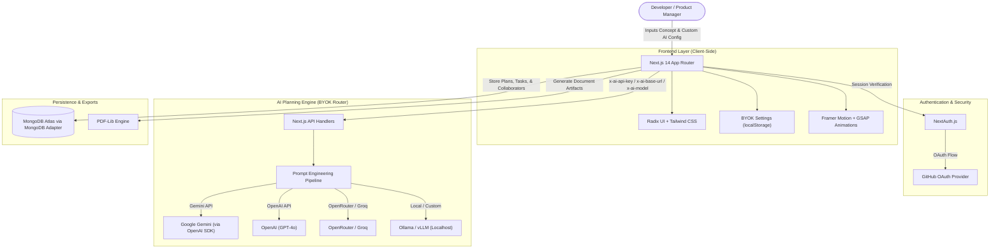

<div align="center">

# 🏛️ Architect AI

**AI-Powered Software Architecture & Project Planning Engine**

[](https://nextjs.org/)
[](https://www.typescriptlang.org/)
[](https://ai.google.dev/)
[](https://www.mongodb.com/)
[](https://tailwindcss.com/)
[](LICENSE)

*Architect AI transforms unstructured product ideas into production-ready software specifications, system architectures, database schemas, and AI-optimized coding prompts.*

</div>

---

## 📌 Overview

Building complex software requires rigorous planning: defining requirements, mapping relational schemas, designing REST/GraphQL API contracts, and structuring tasks. 

**Architect AI** automates this entire discovery phase. Featuring a flexible **Bring Your Own Key (BYOK)** architecture with first-class support for **OpenAI-compatible endpoints** (Google Gemini, OpenAI GPT-4o, OpenRouter, Groq, and local Ollama/vLLM models), the engine synthesizes high-level project ideas into comprehensive Waterfall and Agile specifications, cutting down architecture planning time from days to minutes.

---

## ✨ Key Features

### 🔑 1. Bring Your Own Key (BYOK) & Multi-Provider Support
* **Multi-Provider Presets:** Built-in 1-click presets for **Google Gemini** (free tier), **OpenAI** (GPT-4o), **OpenRouter**, and **Groq**.
* **OpenAI-Compatible Custom Endpoints:** Connect any local or self-hosted endpoint (such as `http://localhost:11434/v1` for **Ollama**, **vLLM**, or **LM Studio**).
* **Zero Database Key Storage:** Keys are saved strictly in client-side browser `localStorage` and sent over HTTPS request headers. User API credentials are never written to MongoDB or server logs.
* **Connection Tester:** Test and validate your credentials and target model before starting a generation.

### 📋 2. Automated Waterfall Specification Engine
* Generates full **Product Requirement Documents (PRDs)** with user stories, edge cases, and acceptance criteria.
* Produces **Entity-Relationship Data Schemas** with relational types, indexes, and primary/foreign keys.
* Crafts **REST & GraphQL API Contracts** including request/response schemas, status codes, and auth requirements.
* Breaks down implementations into phased, actionable engineering tasks.

### ⚡ 3. "Vibe Coder" One-Shot Prompt Synthesizer
* Compiles complex, multi-tiered architectures into high-density **one-shot system prompts** optimized for AI coding assistants (Cursor, Claude 3.5 Sonnet, Copilot).
* Bridges the gap between high-level architectural intent and deterministic code generation.

### 🚀 4. Dynamic Quick-Start Scaffolder
* Automatically generates starter directory file trees tailored to the project stack.
* Produces production-ready `package.json` configurations with pinned dependencies.

### 👥 5. Collaborative Workspace & Export
* Shareable read/write invite links for cross-functional engineering teams.
* Export specifications to PDF via `pdf-lib` or raw structured JSON for integration into internal tooling.

---

## 🏗️ System Architecture



---

## 🛠️ Tech Stack

* **Framework:** Next.js 14 (App Router, Server Actions, Route Handlers)
* **Language:** TypeScript 5 (Strict Mode)
* **AI Architecture:** Bring Your Own Key (BYOK) with OpenAI SDK client targeting Gemini, OpenAI, Groq, OpenRouter, and Ollama
* **Database:** MongoDB Atlas with `@auth/mongodb-adapter`
* **Authentication:** NextAuth.js (GitHub OAuth)
* **Styling & UI:** Tailwind CSS, Radix UI Primitives, Lucide Icons, Sonner toasts
* **Animations:** Framer Motion, GSAP, OGL (WebGL Canvas)
* **Document Generation:** `pdf-lib`, `prism-react-renderer`

---

## 🚀 Getting Started

### Prerequisites
* Node.js 18.x or higher
* npm or pnpm
* MongoDB Atlas instance (or local MongoDB)
* GitHub OAuth App (Client ID & Secret)
* An API key from **Google AI Studio** (Gemini - free tier recommended), **OpenAI**, **OpenRouter**, or a local **Ollama** instance

### 1. Clone the repository
```bash
git clone https://github.com/KareemAdelAwwad/ArchitectAI.git
cd ArchitectAI
```

### 2. Install dependencies
```bash
npm install
```

### 3. Configure environment variables
Copy `.env.example` to `.env.local` and populate the values:
```bash
cp .env.example .env.local
```

```env
# Database Configuration (MongoDB)
MONGODB_URI=mongodb+srv://<username>:<password>@cluster.mongodb.net/ArchitectAI

# NextAuth Configuration
NEXTAUTH_URL=http://localhost:3000
NEXTAUTH_SECRET=your_nextauth_secret

# GitHub OAuth Provider
GITHUB_ID=your_github_client_id
GITHUB_SECRET=your_github_client_secret

# Optional Server Fallback AI Configuration
# (Users can provide their own key directly in the web UI)
OPENAI_API_KEY=optional_server_fallback_key
OPENAI_BASE_URL=https://generativelanguage.googleapis.com/v1beta/openai/
OPENAI_MODEL=gemini-2.5-pro
```

### 4. Run the development server
```bash
npm run dev
```

Open [http://localhost:3000](http://localhost:3000) in your browser.

### 5. Configure your AI Key in the UI
1. Click the **AI Model** key icon in the top right navigation bar.
2. Select your provider (**Google Gemini**, **OpenAI**, **OpenRouter**, **Groq**, or **Custom/Ollama**).
3. Paste your API key (get a free Gemini key from [Google AI Studio](https://aistudio.google.com/app/apikey)).
4. Click **Test Connection** to verify your endpoint.
5. Click **Save Configuration** and generate your plan!

---

## 🔒 Security & Privacy

* **Zero Server Key Storage:** User API keys are stored solely in the client browser's `localStorage` and never persisted to the MongoDB Atlas database.
* **Encrypted Database Access:** MongoDB access is isolated and authenticated through TLS-encrypted connections.
* **Zero Credential Commits:** Sensitive secrets are managed strictly through deployment environment variables.

---

## 👨‍💻 Author

**Kareem Adel**
* Website: [kareem-adel.com](https://kareem-adel.com)
* GitHub: [@KareemAdelAwwad](https://github.com/KareemAdelAwwad)
* LinkedIn: [linkedin.com/in/kareem-adel-awwad](https://linkedin.com/in/kareem-adel-awwad)

---

## 📄 License

This project is licensed under the [MIT License](LICENSE).
